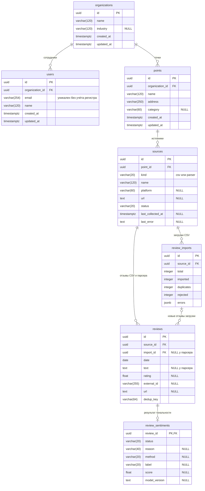

# Схема БД reo

PostgreSQL 16 + pgvector (образ `pgvector/pgvector:pg16`). Модели — `be/app/models/`, миграции — `be/alembic/versions/`.

Состав после REO-36: организация, пользователь, точка, источники, отчёты CSV-импортов, отзывы, результаты тональности и расширение `vector`. Затронуты Сергей (API), Михаил (сбор данных), Камиль (анализ).

Изменения — только новой миграцией и через PR с пометкой для Сергея, Михаила и Камиля. Влитую миграцию не редактируем.

---

## 1. Общие соглашения

| Что | Правило |
|---|---|
| Имена таблиц | `snake_case`, во множественном числе: `organizations`, `users`, `points` |
| Имена колонок | `snake_case`, в единственном числе |
| Первичный ключ | `id uuid`, генерируется в БД: `DEFAULT gen_random_uuid()`. Результат тональности использует UUID отзыва |
| Внешний ключ | `<сущность>_id`, например `organization_id`. Индекс на каждом FK |
| Время записи | `created_at` и `updated_at` — `timestamptz NOT NULL DEFAULT now()`; `updated_at` обновляет SQLAlchemy при изменении записи. Хранится в UTC, показывается в Europe/Moscow ([data-rules.md](data-rules.md)) |
| Изоляция организаций | Каждая таблица с данными организации имеет `organization_id NOT NULL` → `organizations.id`, напрямую или через родителя (отзыв → точка → организация) |
| Удаление | Зависимые данные удаляются каскадно: `ON DELETE CASCADE`. Удаление точки удаляет её источники и отзывы (решение 10.11) |
| Строки | `varchar(n)` с лимитом из формы на экране; необязательные поля — `NULL`, а не пустая строка |
| Ограничения и индексы | Имена задаются автоматически (`naming_convention` в `be/app/models/base.py`): `pk_<таблица>`, `fk_<таблица>_<колонка>_<куда>`, `ix_<таблица>_<колонка>`, `uq_<таблица>_<колонка>`, `ck_<таблица>_<имя>` |

## 2. ER-диаграмма

## 3. Таблицы

Таблицы содержат `created_at` и `updated_at`. Первичный ключ `id` используется везде, кроме `review_sentiments`, где ключом служит `review_id`.

### `organizations` — организация

Бизнес-клиент: сеть кафе, магазинов, клиник. Создаётся при регистрации (E10), до этого — seed-скриптом `be/app/seed.py` (REO-27): две демо-организации с точками.

| Колонка | Тип | NULL | Описание |
|---|---|---|---|
| `name` | `varchar(120)` | нет | Название организации |
| `industry` | `varchar(120)` | да | Отрасль — необязательное текстовое поле в настройках (P1) |

### `users` — пользователь

Сотрудник организации. Один пользователь — одна организация; ролей и приглашений в MVP нет.

| Колонка | Тип | NULL | Описание |
|---|---|---|---|
| `organization_id` | `uuid` | нет | FK → `organizations.id`, `ON DELETE CASCADE`, индекс `ix_users_organization_id` |
| `email` | `varchar(254)` | нет | Логин. Уникален без учёта регистра: индекс `uq_users_email_lower` по `lower(email)`. Бэкенд сохраняет email в нижнем регистре |
| `name` | `varchar(120)` | нет | Имя, редактируется в профиле |

Пароля пока нет: текущего пользователя подставляет заглушка `get_current_user` (`be/app/deps.py`, REO-27) — демо-пользователь из seed. `password_hash` добавится миграцией в E10.

### `points` — точка

Филиал организации (экран M1).

| Колонка | Тип | NULL | Описание |
|---|---|---|---|
| `organization_id` | `uuid` | нет | FK → `organizations.id`, `ON DELETE CASCADE`, индекс `ix_points_organization_id` |
| `name` | `varchar(120)` | нет | Название |
| `address` | `varchar(250)` | нет | Адрес |
| `category` | `varchar(60)` | да | Категория, используется в фильтре выборки (S1) |

Уникальности нет: одинаковый адрес допустим, совпадение названия и адреса — только предупреждение в интерфейсе.

### `sources` — источник отзывов

| Колонка | Тип | NULL | Описание |
|---|---|---|---|
| `point_id` | `uuid` | нет | FK → `points.id`, CASCADE, индекс |
| `kind` | `varchar(20)` | нет | CHECK: `csv` или `parser` |
| `name` | `varchar(120)` | нет | Для CSV — «Импорт CSV», для парсера — название подключения |
| `platform` | `varchar(60)` | да | Площадка парсера; CSV — `null` |
| `url` | `text` | да | Страница точки на площадке; CSV — `null` |
| `status` | `varchar(20)` | нет | `checking`, `collecting`, `ok`, `error`, `paused`; по умолчанию `ok` |
| `last_collected_at` | `timestamptz` | да | Время последнего получения новых отзывов |
| `last_error` | `text` | да | Последняя ошибка подключения |

Частичный уникальный индекс `uq_sources_csv_point` на `point_id WHERE kind = 'csv'` гарантирует один CSV-источник точки, в том числе при одновременных загрузках. Парсерных источников может быть несколько. API точек вычисляет `sources_count` и `data_status` по подключениям точки при чтении ([контракт API](api-contract.md#21-объект-point)).

### `review_imports` — отчёт CSV-импорта

| Колонка | Тип | NULL | Описание |
|---|---|---|---|
| `source_id` | `uuid` | нет | FK → `sources.id`, CASCADE, индекс |
| `total`, `imported`, `duplicates`, `rejected` | `integer` | нет | Счётчики ответа API, CHECK: неотрицательные и `total = imported + duplicates + rejected` |
| `errors` | `jsonb` | нет | Массив ошибок `{row, field, code, message}`, включая ошибки полностью отклонённой загрузки |

`id` этой записи возвращается как `import_id`. Каждый структурно корректный файл создаёт новый отчёт, даже при нуле новых отзывов. Сырые файлы и имена авторов не сохраняются. Уникальная пара `(id, source_id)` служит целью составного FK из `reviews`.

### `reviews` — общая таблица отзывов CSV и парсера

| Колонка | Тип | NULL | Описание |
|---|---|---|---|
| `source_id` | `uuid` | нет | FK → `sources.id`, CASCADE, индекс; точка определяется через источник |
| `import_id` | `uuid` | да | Индекс; составной FK `(import_id, source_id)` → `review_imports(id, source_id)`, CASCADE: импорт и отзыв обязательно принадлежат одному источнику |
| `date` | `date` | нет | День публикации по Europe/Moscow |
| `text` | `text` | да | CSV требует непустой текст; парсер может получить только оценку |
| `rating` | `double precision` | да | CHECK: 1–5 включительно; пустая оценка — `null` |
| `external_id` | `varchar(255)` | да | Идентификатор отзыва площадки; CSV — `null` |
| `url` | `text` | да | Ссылка на оригинал; CSV — `null` |
| `dedup_key` | `varchar(64)` | нет | SHA-256 ключа идентичности в источнике |

Уникальность `(source_id, dedup_key)` исключает дубли на уровне БД. Для CSV ключ — SHA-256 от JSON-массива `[date в ISO, нормализованный text, rating как float либо null]` (`ensure_ascii=False`, `separators=(",", ":")`, UTF-8). Для парсера при наличии внешнего ID следует хешировать `["external_id", external_id]`, иначе использовать такой же ключ по полям. Два разных источника не дедуплицируются между собой. Авторов и контакты не храним.

CSV сохраняет `import_id` только у новых отзывов, парсер — `null`. Повторный импорт не переносит существующий отзыв в новую загрузку. Отчёт, новые отзывы и источник фиксируются одной транзакцией; ошибка сохранения не оставляет частичного результата. Удаление точки каскадно удаляет источник, отчёты импортов и отзывы.

Изоляция: `sources`, `review_imports`, `reviews` получают организацию через `sources.point_id → points.organization_id`. Чтение по `import_id` сначала проверяет импорт через JOIN с источником и точкой текущей организации; отсутствующий и чужой импорт дают одинаковый 404. Для анализа используются строго отзывы с этим `reviews.import_id`, а не все отзывы источника.

### `review_sentiments` — результат анализа тональности

| Колонка | Тип | NULL | Описание |
|---|---|---|---|
| `review_id` | `uuid` | нет | PK и FK → `reviews.id`, CASCADE |
| `status` | `varchar(20)` | нет | `done` (ML вернул `ok`), `skipped`, `error` |
| `reason` | `varchar(40)` | да | Причина пропуска от ML или код ошибки запроса, например `ml_http_503` |
| `method`, `label` | `varchar(20)` | да | Метод `model` или `rating`; метка `positive`, `neutral` или `negative` |
| `p_pos`, `p_neu`, `p_neg` | `double precision` | да | Вероятности классов для `done` |
| `score` | `double precision` | да | Число от −1 до 1 для `done` |
| `model_version` | `text` | да | Версия из ответа ML для `done` и `skipped` |
| `analyzed_at` | `timestamptz` | да | Время получения результата `done` или `skipped` |

Организация определяется через отзыв и его источник. Отсутствие строки означает, что результата пока нет. Первичный ключ защищает от дублей, в том числе при параллельных запусках. Повтор может заменить строку со статусом `error`. Удаление отзыва удаляет его результат.

## 4. Расширения

| Расширение | Зачем | Где создаётся |
|---|---|---|
| `vector` (pgvector) | Эмбеддинги отзывов для выделения проблем клиентов (E6) | Первая миграция: `CREATE EXTENSION IF NOT EXISTS vector`. При откате миграции не удаляется |

`gen_random_uuid()` встроена в PostgreSQL 13+, расширение `pgcrypto` не нужно.

## 5. Что появится дальше

| Эпик | Таблицы | Автор |
|---|---|---|
| E2 (REO-8), после REO-34 | Парсер, управление источниками, фоновые задачи сбора. Источники, отзывы и отчёты CSV-импортов уже добавлены | Михаил |
| E3 (REO-9), после REO-36 | Агрегаты по (точка, источник, день). Результаты тональности уже сохраняются | Камиль |
| E6 | Эмбеддинги (`vector`) и группы проблем клиентов | Артём, Камиль |
| E10 | `users.password_hash` для входа по логину и паролю | Сергей |

## 6. Миграции

- Миграции применяются при старте контейнера `api`: `alembic upgrade head`, затем запуск uvicorn. Если БД недоступна или миграция упала, контейнер завершается.
- Новая миграция: изменить модели в `be/app/models/` → `alembic revision --autogenerate -m "что изменилось"` → проверить сгенерированный файл (autogenerate не видит всего: расширения, данные, переименования) → `alembic upgrade head` и `alembic downgrade -1` на локальной БД.
- Две миграции от одной родительской (параллельные ветки) — после слияния второй PR перебазирует свою миграцию на новую голову (`down_revision`). В `main` всегда одна голова: `alembic heads`.

Команды и тесты миграций — в [be/README.md](../be/README.md#миграции).
