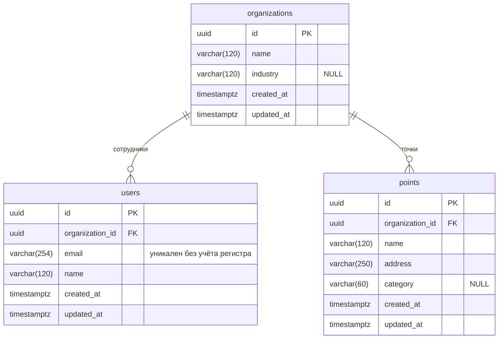

# Схема БД reo

PostgreSQL 16 + pgvector (образ `pgvector/pgvector:pg16`). Модели — `be/app/models/`, миграции — `be/alembic/versions/`.

Состав на E0 (решение 08.11): организация, пользователь, точка и расширение `vector`. Остальные таблицы проектируются в своих эпиках — см. [«Что появится дальше»](#что-появится-дальше).

Изменения — только новой миграцией и через PR с пометкой для Сергея, Михаила и Камиля. Влитую миграцию не редактируем.

---

## 1. Общие соглашения

| Что | Правило |
|---|---|
| Имена таблиц | `snake_case`, во множественном числе: `organizations`, `users`, `points` |
| Имена колонок | `snake_case`, в единственном числе |
| Первичный ключ | `id uuid`, генерируется в БД: `DEFAULT gen_random_uuid()` |
| Внешний ключ | `<сущность>_id`, например `organization_id`. Индекс на каждом FK |
| Время записи | `created_at` и `updated_at` — `timestamptz NOT NULL DEFAULT now()`; `updated_at` обновляет SQLAlchemy при изменении записи. Хранится в UTC, показывается в Europe/Moscow ([data-rules.md](data-rules.md)) |
| Изоляция организаций | Каждая таблица с данными организации имеет `organization_id NOT NULL` → `organizations.id`, напрямую или через родителя (отзыв → точка → организация) |
| Удаление | Зависимые данные удаляются каскадно: `ON DELETE CASCADE`. Удаление точки удаляет её источники и отзывы (решение 10.11) |
| Строки | `varchar(n)` с лимитом из формы на экране; необязательные поля — `NULL`, а не пустая строка |
| Ограничения и индексы | Имена задаются автоматически (`naming_convention` в `be/app/models/base.py`): `pk_<таблица>`, `fk_<таблица>_<колонка>_<куда>`, `ix_<таблица>_<колонка>`, `uq_<таблица>_<колонка>`, `ck_<таблица>_<имя>` |

## 2. ER-диаграмма

## 3. Таблицы

Колонки `id`, `created_at`, `updated_at` есть во всех таблицах (раздел 1) и ниже не повторяются.

### `organizations` — организация

Бизнес-клиент: сеть кафе, магазинов, клиник. Создаётся при регистрации (E10), до этого — seed-скриптом `be/app/seed.py` (REO-27): две демо-организации с точками.

| Колонка | Тип | NULL | Описание |
|---|---|---|---|
| `name` | `varchar(120)` | нет | Название организации |
| `industry` | `varchar(120)` | да | Отрасль — необязательное текстовое поле в настройках (P1) |

### `users` — пользователь

Сотрудник организации. Один пользователь — одна организация; ролей и приглашений в MVP нет.

| Колонка | Тип | NULL | Описание |
|---|---|---|---|
| `organization_id` | `uuid` | нет | FK → `organizations.id`, `ON DELETE CASCADE`, индекс `ix_users_organization_id` |
| `email` | `varchar(254)` | нет | Логин. Уникален без учёта регистра: индекс `uq_users_email_lower` по `lower(email)`. Бэкенд сохраняет email в нижнем регистре |
| `name` | `varchar(120)` | нет | Имя, редактируется в профиле |

Пароля пока нет: текущего пользователя подставляет заглушка `get_current_user` (`be/app/deps.py`, REO-27) — демо-пользователь из seed. `password_hash` добавится миграцией в E10.

### `points` — точка

Филиал организации (экран M1).

| Колонка | Тип | NULL | Описание |
|---|---|---|---|
| `organization_id` | `uuid` | нет | FK → `organizations.id`, `ON DELETE CASCADE`, индекс `ix_points_organization_id` |
| `name` | `varchar(120)` | нет | Название |
| `address` | `varchar(250)` | нет | Адрес |
| `category` | `varchar(60)` | да | Категория, используется в фильтре выборки (S1) |

Уникальности нет: одинаковый адрес допустим, совпадение названия и адреса — только предупреждение в интерфейсе.

## 4. Расширения

| Расширение | Зачем | Где создаётся |
|---|---|---|
| `vector` (pgvector) | Эмбеддинги отзывов для выделения проблем клиентов (E6) | Первая миграция: `CREATE EXTENSION IF NOT EXISTS vector`. При откате миграции не удаляется |

`gen_random_uuid()` встроена в PostgreSQL 13+, расширение `pgcrypto` не нужно.

## 5. Что появится дальше

| Эпик | Таблицы | Автор |
|---|---|---|
| E2 (REO-8) | Источники, отзывы, задачи сбора и импорта. Отзыв связан с точкой и источником; FK на `points` с `ON DELETE CASCADE` | Михаил |
| E3 (REO-9) | Результаты анализа тональности, агрегаты по (точка, источник, день) | Камиль |
| E6 | Эмбеддинги (`vector`) и группы проблем клиентов | Артём, Камиль |
| E10 | `users.password_hash` для входа по логину и паролю | Сергей |

## 6. Миграции

- Миграции применяются при старте контейнера `api`: `alembic upgrade head`, затем запуск uvicorn. Если БД недоступна или миграция упала, контейнер завершается.
- Новая миграция: изменить модели в `be/app/models/` → `alembic revision --autogenerate -m "что изменилось"` → проверить сгенерированный файл (autogenerate не видит всего: расширения, данные, переименования) → `alembic upgrade head` и `alembic downgrade -1` на локальной БД.
- Две миграции от одной родительской (параллельные ветки) — после слияния второй PR перебазирует свою миграцию на новую голову (`down_revision`). В `main` всегда одна голова: `alembic heads`.

Команды и тесты миграций — в [be/README.md](../be/README.md#миграции).
